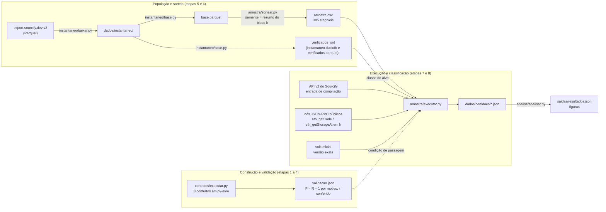

# Verificador de cobertura de atestação (`atesta`)

[](https://doi.org/10.5281/zenodo.24455137)

Código e dados do artigo "Cobertura de atestação em contratos inteligentes verificados: construção de um verificador e
medição das regiões de *bytecode* não cobertas pelo selo de verificação no Ethereum", de João Vitor Munaretto, Kauê
Iran Bezerra e Thalles Mageste Fouly Gonçalves, com orientação do Prof. Bruno William Wisintainer (Trabalho de
Conclusão de Curso de Engenharia da Computação, UniSociesc, 2026).

Execução completa da Metodologia do artigo (seções 3.4 a 3.8), do verificador aos números da seção 4. O pacote
`atesta` recompila cada contrato com a entrada que o acervo do Sourcify guarda, delimita no código de execução lido
da cadeia as regiões não atestadas, materializa o valor gravado em cada uma, calcula a cobertura de atestação
(Equação 1) e o indicador da Equação (2), classifica o alvo das constantes do tipo `address` e emite uma certidão em
JSON. Os oito contratos-controle rodam numa cadeia local em memória; a amostra, na rede principal.

A rede principal só é lida: o verificador não envia transação nem usa chave. Só há escrita em cadeias py-evm em memória:
a dos contratos-controle e dos testes, com uma chave de teste fixa e pública (32 bytes 0x01), e a de
`analise/complementares/proxies_delegacao_alvos.py` e `proxies_troca_local.py`, com chaves do mesmo tipo (32 bytes 0x02
e 0x07). Nenhuma dessas chaves tem valor, e nenhuma deve ser usada em rede real. Os nós JSON-RPC são públicos e sem
chave (lista em `atesta/config.py`); para trocá-los, use a chave `RPCS` em `.env.local` (linha `RPCS=<url>,<url>`) ou a
variável de ambiente `ATESTA_RPCS`, com as URLs separadas por vírgula, ambas fora do controle de versão. As mensagens de
falha de RPC trazem a URL do nó: com um nó que exige chave, confira os registros antes de publicá-los.

## O que tem aqui

| Pasta | Conteúdo |
|---|---|
| `atesta/` | O verificador: `regioes.py` (delimitação de F(a), coincidência byte a byte, constantes, τ), `compilador.py` (solc oficial com sha256 conferido, `--standard-json`), `rpc.py` (leitura ancorada em bloco, com reserva entre nós e cache), `acervo.py` (API v2 do Sourcify), `classificacao.py` (classes do alvo e ERC-1967), `verificador.py` (certidão), `estatistica.py` (Equações 2 a 7) |
| `instantaneo/` | `baixar.py`: colunas necessárias de cinco tabelas da exportação Parquet v2 do Sourcify, com manifesto (chave, tamanho, ETag e data de cada arquivo); `base.py`: base de amostragem e conjunto de verificados da rede principal; `verificados.py`: monta, a partir de `dados/verificados.parquet`, o banco que `amostra/executar.py` consulta |
| `controles/` | `contratos/`: os oito contratos-controle (modelo `Controles.sol.tpl` e `Metadados.sol`); `rede_local.py`: cadeia py-evm em memória (Cancun); `executar.py`: implanta, registra o gabarito, calcula P e R por motivo e confere com o gabarito o τ de cada região e o tipo declarado das de variável imutável. Versões preenchidas, gabarito e certidões dos controles em `controles/gerados/` |
| `amostra/` | `sortear.py`: permutação com semente = resumo do bloco de referência, critério da cadeia, 385 elegíveis; `executar.py`: certidão de cada contrato, com a classificação do alvo; `piloto.py`: ensaio fora da amostra, antes do sorteio; `piloto_refazer.py`: refaz com a versão atual as falhas do ensaio |
| `analise/` | `analisar.py`: números da seção 4 (`saidas/resultados.json`) e Figura 2; `resumo_md.py`: gera `RESULTADOS.md`; `complementares/`: conferências descritivas citadas nas subseções 4.1, 4.2 e 4.6 |
| `tests/` | `pytest`: Wilson contra o scipy, Newcombe contra o exemplo do artigo original, n = 385, regra das perdas, oito controles, o caminho viaIR da proteção de chamada e o valor de imutável atribuído por literal, que aparece no código de criação (P-18) |
| `dados/` | Gerado pelos programas: `sorteio_semente.json`, `sorteio.json`, `amostra.csv`, `certidoes/`, `execucao.json`, `base_resumo.json`, `instantaneo/manifesto.json`, `piloto/` (ensaio) e `complementares/` (respostas e extratos das conferências complementares). Montados à parte: `falhas_diagnosticadas.json`, `ensaio_sobrescritos.json`, `execucao_periodo.json`, `estimativas_1.6.0.txt` (Tabela 3 da rodada da 1.6.0) e `logs/` (saída de `amostra/executar.py` em cada rodada sobre a amostra, gravada pelo terminal com as horas de início e de fim). `base.parquet` e `verificados.parquet` ficam fora do repositório (ver Arquivos fora do repositório) |
| `saidas/` | Gerado: `validacao.json`, `validacao_historico.jsonl` (uma linha por rodada de validação), `resultados.json`, `figuras/` e `complementares/` |
| `.cache/solc/` | `list.json` e `soljson-list.json`: listas oficiais do compilador baixadas em 29/10/2026, que fixam a escolha entre o binário nativo e o soljson; os binários não vão ao repositório |
| `PROBLEMAS.md` | O que deu errado na execução, a causa, a correção e o efeito sobre o método |
| `RESULTADOS.md` | Resumo legível dos números da rodada que alimentou o artigo (gerado por `analise/resumo_md.py`) |
| `CERTIDAO.md` | Especificação da certidão `certidao-atesta/1`, campo a campo |
| `js/` | `solcjs.js`: ponte para o compilador oficial em JavaScript (soljson), usado nas versões nightly, nas anteriores à 0.4.11 e quando a lista oficial para Windows não tem o binário da versão longa exata |

## O que o artigo diz que é publicado e onde está

| Item (subseção 3.8 do artigo) | Onde |
|---|---|
| Código do verificador, com a versão | `atesta/` (versão 1.7.0, em `atesta/__init__.py`), na etiqueta `artigo-2026-11` deste repositório |
| Programa de sorteio, com o gerador e a versão | `amostra/sortear.py`, na mesma etiqueta; NumPy 2.5.4, PCG64 (`requirements.lock.txt`) |
| Programas de análise, com a versão | `analise/`, na mesma etiqueta |
| Semente (resumo do bloco de referência) | `dados/sorteio_semente.json` e `dados/sorteio.json` |
| Base de amostragem, na ordem a que se aplica a permutação | `dados/base.parquet` (coluna `indice`, em ordem de endereço), fora do repositório |
| Manifesto dos arquivos de origem do instantâneo | `dados/instantaneo/manifesto.json` |
| Contratos examinados, exclusões e perdas | `dados/amostra.csv` e `dados/certidoes/` |
| Data do instantâneo e altura do bloco de referência | `listado_em` em `dados/instantaneo/manifesto.json`; `bloco_referencia` em `dados/sorteio.json` |
| Versões do compilador | campo `acervo.compilador` das certidões e coluna `compilador` de `dados/amostra.csv`; em `saidas/resultados.json`, faixas de versão por grau (`compiladores_por_grau`) e recompilações por motor e grau (`motores`) |
| Leituras da rede principal e respostas da API do acervo | `.cache/rpc_rede_principal.sqlite` e `.cache/sourcify_api.sqlite`, fora do repositório |
| Formato da certidão e certidões | `CERTIDAO.md` e `dados/certidoes/` |
| Contratos-controle: código-fonte, endereços e gabaritos | `controles/contratos/`, `controles/gerados/` e `saidas/validacao.json` |

## Arquitetura



## Arquivos fora do repositório

O GitHub não aceita arquivo acima de 100 MiB, e os bancos de `.cache/` guardam conteúdo de terceiros (ver Licença). Os
quatro arquivos abaixo estão anexados à versão `artigo-2026-11` deste repositório
(https://github.com/DJd3str013r/TCC-2026-ENGCOMP/releases/tag/artigo-2026-11). Baixe cada um para o caminho indicado e
confira o SHA-256 antes de rodar os programas; `anexos.sha256` traz os mesmos resumos da tabela.

| Caminho | Bytes | SHA-256 |
|---|---|---|
| `dados/base.parquet` | 968.743.356 | `07647059d4def08cc218d7ec14a595c36d1ba62f05ab55495daf067722013833` |
| `dados/verificados.parquet` | 239.411.356 | `5db57647955cd4d70d035bafd9432d24eea72c77296cd95780ea7467e16539a8` |
| `.cache/rpc_rede_principal.sqlite` | 41.635.840 | `b0539559cb24e56611e9956980929bdffa73938715403f4c582f85615e37ad12` |
| `.cache/sourcify_api.sqlite` | 83.918.848 | `5cfa01b796a32c7ca443643f5f94688195d5eb19416e74604b1ae53d55600db4` |

```bash
v=https://github.com/DJd3str013r/TCC-2026-ENGCOMP/releases/download/artigo-2026-11
curl -L -o dados/base.parquet $v/base.parquet
curl -L -o dados/verificados.parquet $v/verificados.parquet
curl -L -o .cache/rpc_rede_principal.sqlite $v/rpc_rede_principal.sqlite
curl -L -o .cache/sourcify_api.sqlite $v/sourcify_api.sqlite
sha256sum -c anexos.sha256
```

O banco de leituras da rede principal tem 7.373 leituras. No bloco de referência, 26.296.341, estão a do próprio bloco,
cujo resumo é a semente; as 6.986 de código lidas na ordem da permutação pelo primeiro sorteio, interrompido (P-10), das
quais as 385 primeiras são as dos contratos da amostra; as 29 de código dos alvos das constantes, tirados o endereço
nulo e o próprio contrato; e as 62 dos compartimentos ERC-1967 dos 31 alvos com código. No bloco 26.290.000, estão as
291 do ensaio e as de 4 consultas anteriores a ele. O banco da API tem 680 respostas: 385 da amostra, 291 do ensaio e as
das mesmas 4 consultas. Não são publicados `dados/instantaneo.duckdb` (3,3 GB), as colunas projetadas de
`dados/instantaneo/` (4,0 GB) nem os binários do compilador, que `atesta/compilador.py` baixa de
binaries.soliditylang.org e confere pelo SHA-256 da lista oficial.

## Ambiente do estudo

Windows 11 Pro (x86-64), Git Bash, Python 3.12.10 e Node.js 20.15.0 (a versão instalada na máquina do estudo).
`requirements.lock.txt` fixa as versões do ambiente do estudo, entre elas a do NumPy (2.5.4), de que depende a
permutação do sorteio. Use `python`, e não `python3`, que no Windows costuma ser o atalho da Store.

```bash
python -m venv .venv
./.venv/Scripts/python -m pip install -r requirements.lock.txt
cd js && npm ci && cd ..
```

O `npm ci` só é preciso para refazer certidões de contratos compilados pelo soljson.

## Reprodução a partir dos arquivos publicados

1. Estimativas, a partir das certidões e dos dois bancos de `.cache/`, sem rede:

```bash
./.venv/Scripts/python analise/analisar.py
./.venv/Scripts/python -m analise.resumo_md
git diff --exit-code -- saidas/resultados.json RESULTADOS.md
```

O `git diff` não mostra diferença. Os totais na base de amostragem citados no Resumo, no Abstract, na subseção 4.6 e nas
Conclusões do artigo (cerca de 279 mil contratos, com intervalo de 164 mil a 471 mil, e cerca de 258 mil, com intervalo
de 148 mil a 444 mil) são `p`, `l` e `u` de `hipotese_central` e `p` e `ic` de `codigo_de_criacao`, em
`saidas/resultados.json`, multiplicados por `N_base` (8.274.941), de `dados/sorteio.json`, e arredondados ao milhar.

2. Validação nos contratos-controle (baixa o solc 0.8.37 na primeira vez):

```bash
./.venv/Scripts/python -m pytest -q tests
```

O teste não acrescenta rodada ao histórico e deixa `saidas/` e `controles/gerados/` como estão. Já
`controles/executar.py` acrescenta uma rodada a `saidas/validacao_historico.jsonl` e reescreve `saidas/validacao.json` e
`controles/gerados/`; depois dele, `analise/analisar.py` muda três campos do histórico de validação em
`saidas/resultados.json`, `python -m analise.resumo_md` muda a contagem de rodadas posteriores à medição em
`RESULTADOS.md`, e `git checkout -- saidas controles/gerados RESULTADOS.md` volta ao estado publicado.

3. Sorteio, sem rede (precisa de `dados/base.parquet` e de `.cache/rpc_rede_principal.sqlite` e carrega na memória as
8.274.941 linhas da base):

```bash
./.venv/Scripts/python amostra/sortear.py --bloco 26296341
git diff --exit-code -- dados/amostra.csv dados/sorteio.json
```

4. Certidões, com rede só para baixar os compiladores (precisa dos dois bancos de `.cache/`, de
`dados/verificados.parquet` e do `npm ci` do Ambiente: 62 dos 385 contratos são recompilados pelo soljson e, sem
`js/node_modules`, saem como falha):

```bash
./.venv/Scripts/python instantaneo/verificados.py
./.venv/Scripts/python amostra/executar.py --refazer
git diff -U0 -- dados/certidoes | grep -E '^[-+] ' | grep -v '"segundos"'
```

A última linha não imprime nada: só o tempo de processamento muda. O `--refazer` também reescreve `dados/execucao.json`
(tempo e número de chamadas à rede), e `git checkout -- dados/certidoes dados/execucao.json` volta ao publicado.

5. Instantâneo e base, com rede. A exportação do Sourcify recebe dados novos todo dia e regrava o arquivo mais recente
de cada tabela. `instantaneo/baixar.py` reaproveita a listagem de `dados/instantaneo/manifesto.json`, mas não confere
se cada arquivo ainda tem o tamanho e o ETag registrados; compare-os com o manifesto antes de rodar
`instantaneo/base.py`, que sobrescreve `dados/base.parquet`, `dados/verificados.parquet` e `dados/base_resumo.json`.
A base do estudo é a da tabela de arquivos fora do repositório.

## Conferências complementares

Contagens e conferências descritivas citadas na seção 4 do artigo, feitas depois da coleta e não previstas na
subseção 3.8. Ficam em `analise/complementares/`, gravam em `saidas/complementares/` e não alteram
`saidas/resultados.json`. Por padrão, nenhuma usa a rede.

| Programa | O que reproduz | Precisa de |
|---|---|---|
| `por_compilacao.py` | Fração por compilação (4.6): as dez compilações mais frequentes reúnem 70,8% dos endereços da base, e os 260 sorteados nelas têm indicador 0; também compilação única, faixas de tamanho e estimador de razão com intervalo por *bootstrap* | `dados/base.parquet` |
| `tipos_declarados.py` | Tipo declarado e τ(r) das 76 constantes de variável imutável, por programa que não usa o verificador: no código-fonte, pelo mapa de fontes do acervo, e, nas 31 públicas, na ABI (4.6); identificador da declaração diferente do registrado pelo acervo em 22 das 76, em dois contratos (4.2) | `.cache/sourcify_api.sqlite` e os compiladores de 11 versões em `.cache/solc/` |
| `proxies_delegacao.py`, `proxies_compartimentos.py`, `proxies_delegacao_alvos.py`, `proxies_administrador.py` e `proxies_troca_local.py`, nesta ordem | Leitura complementar dos *proxies* (4.6): dos 13 positivos, 3 são *proxies* de implementação fixa e 1 executa por delegação, na biblioteca vinculada após a compilação, as 4 funções públicas que não são de consulta; nos 31 alvos com código, nenhum compartimento do ERC-1967 preenchido e 1 com a implementação no compartimento de outro padrão, cujo administrador é conta sem código e, na execução local, troca a implementação | `.cache/sourcify_api.sqlite`, `.cache/rpc_rede_principal.sqlite`, `dados/verificados.parquet` e, em `dados/complementares/`, o extrato do instantâneo e as respostas da leitura de 18/11/2026 |
| `complementacao_entrada.py` | Complementação da entrada pelos metadados do contrato (4.1 e P-13): os 131 contratos com ajustes dão o resultado da certidão tanto com a entrada armazenada quanto com a completada | os dois bancos de `.cache/`, os compiladores de 30 versões em `.cache/solc/` e Node.js com `js/node_modules` |

`tipos_declarados.py` e `complementacao_entrada.py` executam os compiladores que o item 4 da Reprodução baixa e param,
sem gravar nada, se algum faltar. `proxies_compartimentos.py` e `proxies_administrador.py` refazem a leitura de
18/11/2026 a partir das respostas guardadas; com `--rede`, leem de novo a rede principal no bloco de referência, só
leitura, e regravam essas respostas. `proxies_extrato.py` regrava `dados/complementares/proxies_extrato.csv` a partir da
tabela `vigente_endereco` de `dados/instantaneo.duckdb`, que não é publicado. Só `instantaneo/base.py` grava essa
tabela: com o banco que `instantaneo/verificados.py` monta no item 4 da Reprodução, o programa para com erro, sem
regravar o extrato.

## Execução do zero

```bash
python -m venv .venv && ./.venv/Scripts/python -m pip install -r requirements.lock.txt
cd js && npm ci && cd ..

# 1-4. Controles: implanta os oito, valida o verificador (sai com código 1 se reprovar) e registra a rodada no histórico
./.venv/Scripts/python controles/executar.py
./.venv/Scripts/python -m pytest -q tests        # inclui o ensaio viaIR; não grava rodada

# 5. Instantâneo (colunas necessárias) e base de amostragem; a exportação muda todo dia (ver Reprodução, item 5)
./.venv/Scripts/python instantaneo/baixar.py --paralelo 6
./.venv/Scripts/python instantaneo/base.py

# Ensaio antes do sorteio (subseção 3.4): fora da amostra, num bloco anterior ao de referência
./.venv/Scripts/python amostra/piloto.py --n 40 --bloco <altura anterior> --semente <semente do ensaio>

# 6. Sorteio: escolha o bloco de referência antes (a semente é o resumo dele)
./.venv/Scripts/python amostra/sortear.py --bloco <altura>

# 7-8. Execução e classificação (falha do instrumento não exclui: corrigir, revalidar, --refazer)
./.venv/Scripts/python amostra/executar.py --paralelo 6

# 9. Análise e resumo legível
./.venv/Scripts/python analise/analisar.py
./.venv/Scripts/python -m analise.resumo_md
```

No estudo, o ensaio rodou três vezes no bloco 26.290.000, duas com `--n 40 --semente 2026` e uma com `--n 80 --semente
777` (P-08, P-09 e P-19), e `amostra/piloto_refazer.py` refez com a 1.7.0 as 14 falhas que restavam.

Num clone, os registros desta rodada continuam no lugar e mudam o que alguns programas fazem: `amostra/sortear.py` para
com `AssertionError` se o bloco não for o gravado em `dados/sorteio_semente.json`, `instantaneo/baixar.py` reaproveita a
listagem de `dados/instantaneo/manifesto.json` (ver Reprodução, item 5) e `controles/executar.py` acrescenta a rodada ao
histórico publicado (item 2). A chave `historico` de `saidas/resultados.json` sai dos registros do estudo em
`dados/piloto/`, `dados/logs/`, `saidas/validacao_historico.jsonl`, `dados/falhas_diagnosticadas.json` e
`dados/ensaio_sobrescritos.json`, e `analise/analisar.py` para sem gravar nada se `dados/logs/` não tiver nenhuma rodada
ou se uma rodada registrar falha de contrato que não está na amostra ou em `dados/falhas_diagnosticadas.json`, o que
acontece com as rodadas do estudo quando a amostra é outra. Para uma amostra nova, troque as rodadas de `dados/logs/`
pelas da nova execução, gravadas como as do estudo, e registre a causa de cada falha na chave `amostra` de
`dados/falhas_diagnosticadas.json`. Na primeira rodada (nas seguintes, `execucao2`, `execucao3` e assim por diante):

```bash
date -u +%Y-%m-%dT%H:%M:%SZ > dados/logs/execucao-inicio.txt
./.venv/Scripts/python amostra/executar.py --paralelo 6 | tee dados/logs/execucao.log
date -u +%Y-%m-%dT%H:%M:%SZ > dados/logs/execucao-fim.txt
```

Do zero, o estudo precisa de acesso a export.sourcify.dev, sourcify.dev/server, binaries.soliditylang.org,
extensions.duckdb.org (extensão httpfs do DuckDB) e aos nós JSON-RPC, e de cerca de 9 GB de disco: 4,0 GB do instantâneo
projetado, 3,3 GB de `dados/instantaneo.duckdb`, 1,2 GB das bases em Parquet e cerca de 0,8 GB de compiladores para os
385 contratos.

Reprocessar tudo com uma versão nova do verificador: suba `VERSAO` em `atesta/__init__.py`, rode os controles (a
validação precisa aprovar de novo) e `amostra/executar.py` (refaz toda certidão de versão anterior). As leituras da
cadeia ficam em `.cache/rpc_rede_principal.sqlite` e não se repetem.

## Linha de comando

```bash
./.venv/Scripts/python -m atesta 0xE592427A0AEce92De3Edee1F18E0157C05861564 --bloco <altura>
```

Emite na saída padrão a certidão de um contrato da rede principal. A linha de comando não consulta o instantâneo, nem
quando `dados/instantaneo.duckdb` existe: a classe "contrato verificado no acervo" fica indisponível, e os alvos que são
outros contratos saem como contrato sem verificação no acervo. Os nós consultados são sempre os da rede principal,
qualquer que seja `--rede`, e um endereço sem registro no acervo encerra o programa com `ErroAcervo`.

## Fora do Windows

O estudo só foi executado no Windows 11 Pro. `atesta/config.py` usa a lista de binários windows-amd64 do compilador; em
outros sistemas, o verificador (`amostra/executar.py`, `amostra/piloto.py`, `amostra/piloto_refazer.py` e `python -m
atesta`), `controles/executar.py`, `tests/test_controles.py`, `analise/complementares/tipos_declarados.py` e
`analise/complementares/complementacao_entrada.py` não rodam. Os demais programas não foram testados fora do Windows. A
Figura 2 usa a fonte Times New Roman.

## Licença

O código está sob a licença MIT, no arquivo `LICENSE`. Os dados produzidos pelo grupo (certidões, amostra, sorteio,
gabaritos, saídas, figura e registros da execução) estão sob a licença Creative Commons Atribuição 4.0 Internacional (CC
BY 4.0, https://creativecommons.org/licenses/by/4.0/deed.pt-br). Para citar, use o artigo e este repositório, na versão
`artigo-2026-11`, arquivada no Zenodo com o DOI 10.5281/zenodo.24455137 (https://doi.org/10.5281/zenodo.24455137); o DOI
10.5281/zenodo.24455136 reúne todas as versões.

Os contratos-controle declaram MIT na linha SPDX, que faz parte do código compilado e por isso não muda. As duas bases
em Parquet e os bancos de `.cache/` derivam da exportação e da API do Sourcify e de nós JSON-RPC públicos e ficam fora
da licença do grupo. Os códigos-fonte de terceiros guardados nas respostas da API mantêm as condições de quem os
publicou: cada contrato traz a licença que declarou, e a maioria não declara nenhuma. As certidões e as saídas de
`analise/complementares/` repetem dados do acervo tal como publicados, inclusive trechos curtos desses códigos e nomes
de arquivo que às vezes trazem o caminho da máquina de quem compilou o contrato.
